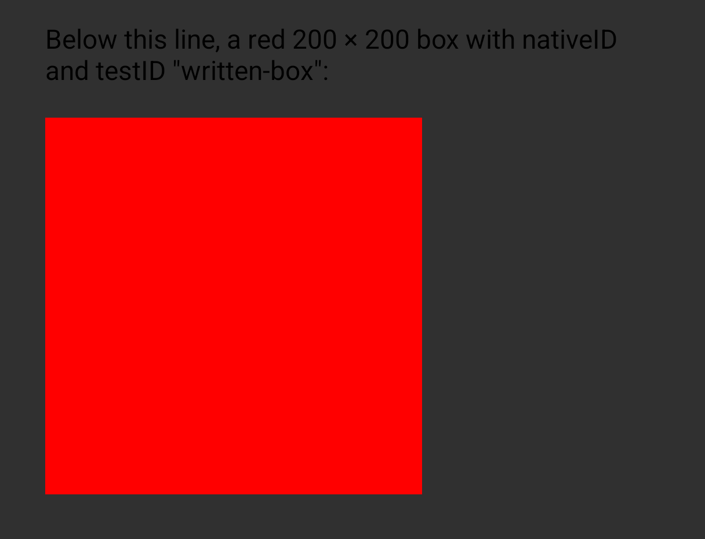
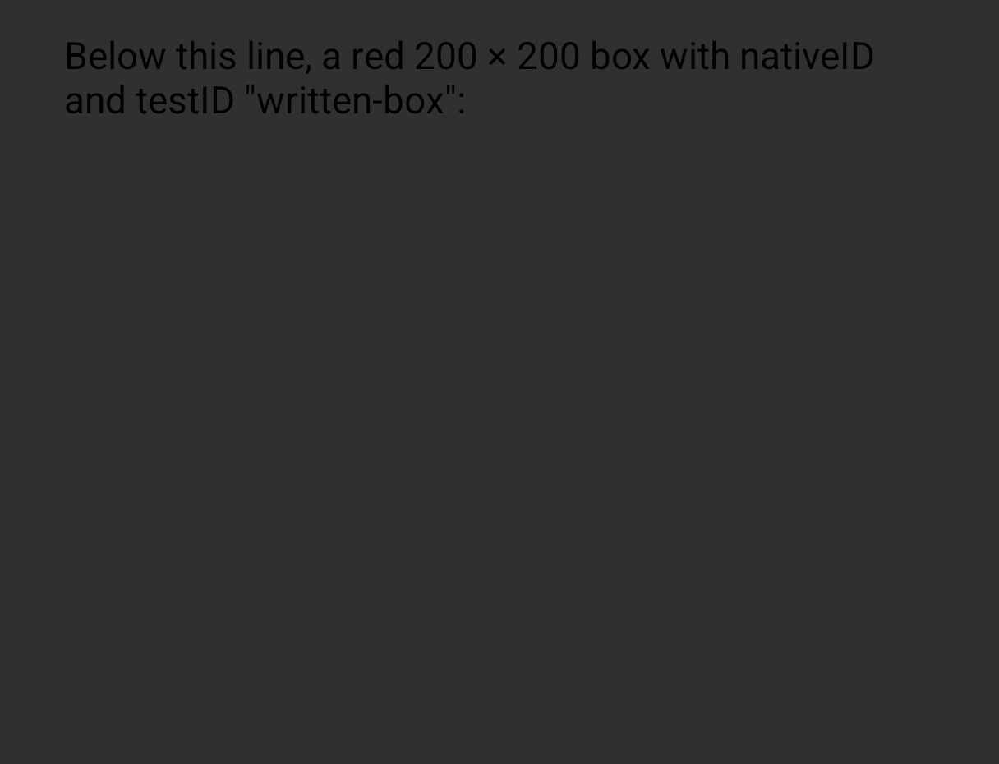

# Android: under `enableFabricCommitBranching`, a commit hook's clone in the branch's merge drops the props the view is created from

A reproducer on React Native's nightly of `main` (`0.90.0-nightly-20261111-1273ca128`), Android only.

`ReproducerApp/android/app/src/main/jni/NativePropsWriter.cpp` is a C++ TurboModule whose `install(prefix)` registers a `UIManagerCommitHook`. In every commit, the hook writes `opacity: 1` onto each node whose `nativeID` starts with the prefix, passing only that prop to `cloneProps`, as Reanimated's `ShadowTreeCloner` does. `App.tsx` installs it for `written-`, then renders a red 200 × 200 box with `nativeID` and `testID` `written-box`. `MainApplication.kt` turns on `enableFabricCommitBranching`.

## Steps

```sh
./reproduce.sh
```

With a device or emulator on adb (`ANDROID_SERIAL` picks one), it runs `yarn install` in `ReproducerApp`, `./gradlew assembleRelease -PreactNativeArchitectures=arm64-v8a` in `ReproducerApp/android`, installs and launches the release APK, prints `adb logcat -s PropsWriter`, which logs each clone the hook makes, and saves `screenshot.png`. It exits 1 while the hook's clone in the merge of React's revision (`commit=ReactRevisionMerge`) holds neither the `nativeID` nor the `backgroundColor` React set, 0 once it keeps them, and 2 when a step fails.

Gradle properties given to the script reach the build:

- `./reproduce.sh -PcommitBranching=false` turns the flag off: the hook clones the node in React's own commit, there is no merge, and the script exits 2.
- `./reproduce.sh -PaccumulatedRawProps=true` also turns on `enableAccumulatedUpdatesInRawPropsAndroid`: each clone keeps its source's raw props, and the script exits 0.

**Expected:** the hook's clone in the merge keeps the raw props React set, as its clone in React's own commit does.

**Actual** with the flag on:

```text
PropsWriter: commit=React tag=10 source rawProps: nativeID=yes backgroundColor=yes; written rawProps: nativeID=yes backgroundColor=yes
PropsWriter: commit=ReactRevisionMerge tag=10 source rawProps: nativeID=yes backgroundColor=yes; written rawProps: nativeID=no backgroundColor=no
```

Where the merge is the commit that creates the view, the view has none of the props React set. On a RedMagic NX809J (Android 16), release builds on `0.89.0-nightly-20261030-4afc5d5b9`:

| `-PcommitBranching=false` | flag on |
| --- | --- |
|  |  |

On a Galaxy S23 (Android 14) the merge's clone loses the same raw props, and the box still shows.
